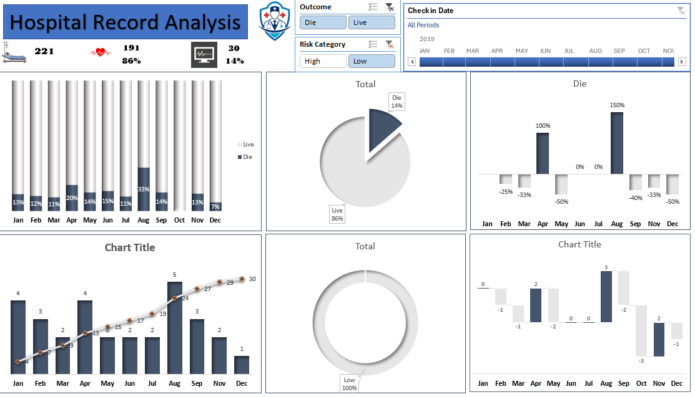

# 🏥 Hospital Record Analysis Dashboard

An advanced healthcare analytics dashboard built to monitor patient outcomes, risk categories, monthly admission trends, and clinical performance.

## 📊 Dashboard Preview

## 📌 Project Overview
- **Objective:** Analyze hospital patient records to evaluate treatment outcomes (Live vs. Die), assess risk categories, track monthly admissions, and improve healthcare delivery insights.
- **Tools Used:** Excel, Pivot Tables, Advanced Formulas, Interactive Dashboards, Slicers.
- **Key Metrics Tracked:**
  - Total Patient Records: **221**
  - Successful Outcomes (Live): **191 (86%)**
  - Critical/Fatal Outcomes (Die): **30 (14%)**
  - Monthly Admission Trends & Risk Categorization

## 📂 Files in this Repository
- `Project Excel 3.xlsx`: The underlying dataset and interactive Excel healthcare dashboard.
- `hospital-dashboard.png`: Visual preview of the hospital records analytics dashboard.
